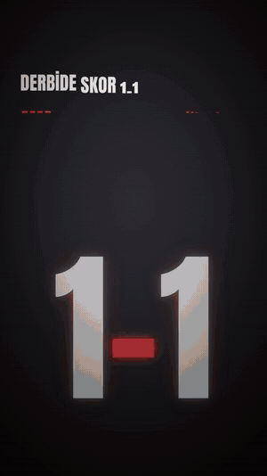
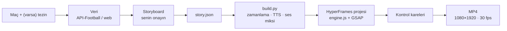
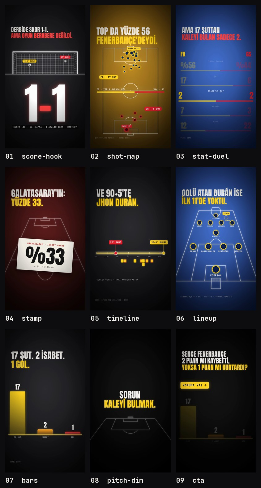

# futbol-analiz-reel

Bir futbol maçının verisinden **dikey (9:16) veri-analiz videosu** üreten bir [Claude](https://claude.ai) skill'i. Instagram Reels, TikTok ve YouTube Shorts için.

Maçı söylersin; Claude istatistikleri bulur, bir iddia etrafında anlatıyı kurar, storyboard'u onayına sunar ve videoyu [HyperFrames](https://hyperframes.heygen.com) ile MP4 olarak render eder. Videoda skor kancası, şut haritası, istatistik düellosu, dakika çizelgesi ve diziliş gibi sahneler var; video "YORUMA YAZ" sorusuyla biter.

<p align="center">
  
</p>

<p align="center"><sub>Bu repodaki örnekle (<code>examples/fb-gs-2025-12-01.json</code>) üretilen videodan kesitler · 1080×1920 · 57 sn</sub></p>

---

## İçindekiler

- [Ne yapar](#ne-yapar)
- [Nasıl çalışır](#nasıl-çalışır)
- [Kurulum](#kurulum)
- [Kullanım](#kullanım)
- [story.json](#storyjson)
- [Sahne tipleri](#sahne-tipleri)
- [Seslendirme](#seslendirme)
- [Veri kaynakları](#veri-kaynakları)
- [Başka bir videonun stilini almak](#başka-bir-videonun-stilini-almak)
- [Klasör yapısı](#klasör-yapısı)
- [Sorun giderme](#sorun-giderme)
- [Kurallar](#kurallar)
- [Lisanslar](#lisanslar)

## Ne yapar

- **Veriyi kendisi toplar.** API-Football anahtarı varsa API'den, yoksa web'den (ESPN, Türk maç anlatımı sayfaları, xG için FotMob/FBref) toplar ve iki kaynakla doğrular. Bulamadığı sayıyı sana sorar; **sayı uydurmaz**.
- **Maç özeti yazmaz, iddia kanıtlar.** Akış şöyledir: kanca (skor + ters köşe cümle) → tez → her sahnede tek sayıyla 2–3 kanıt → neden → ters çevirme → sonuç → iki yorum arasında seçim isteyen soru.
- **11 hazır sahne tipi** var: şut haritası, xG/topla oynama barı, istatistik düellosu, düşen kart, dakika çizelgesi, perspektif saha üstünde diziliş, sütun grafik, panel yığını ve diğerleri.
- **Türkçe altyazı.** `İ Ş Ğ Ü` dahil doğru büyük harf (`tr-TR`) ve kelime kelime maskeden yükselen yazı.
- **İsteğe bağlı seslendirme.** macOS `say`, Edge neural sesleri, ElevenLabs veya Piper. Grafikler seslendirmeyle kendiliğinden eş zamanlı olur, ses -14 LUFS'a normalize edilir.
- **Deterministik render.** Aynı `story.json` her seferinde aynı videoyu verir.

## Nasıl çalışır



İşin merkezinde `story.json` var: sahneler, altyazılar ve her sahnenin verisi bu dosyada durur. `scripts/build.py` bu dosyadan süreleri hesaplar. Seslendirme varsa her altyazının süresini sesten ölçer, yoksa okuma hızından tahmin eder. Sonra kendi başına çalışan bir HyperFrames projesi yazar. Sahne motoru `assets/engine/engine.js`, her sahneyi tek bir GSAP zaman çizelgesine çizer.

Grafiklerin seslendirmeyle eş zamanlı olmasının sırrı **adımlar**. Bir sahnedeki 1. altyazı başladığında görselin 0. adımı oynar, 2. altyazıda 1. adımı oynar. Altyazının söylendiği an, grafiğin geldiği andır.

## Kurulum

### Gereksinimler

| Araç | Neden | Kurulum (macOS) |
|---|---|---|
| Node.js 22+ | HyperFrames (`npx hyperframes`) | `brew install node` |
| ffmpeg | ses miksi, mux, kareler | `brew install ffmpeg` |
| Python 3.9+ ve `numpy`, `pillow` | `build.py`, ses sentezi | `python3 -m pip install --user numpy pillow` |
| Chrome / Chromium | HyperFrames render tarayıcısı | `setup.sh` indirir |

HyperFrames ayrıca kurulmaz; `npx` ile ilk kullanımda iner.

### Claude Code

Skill'i kişisel skill klasörüne klonla, sonra kurulum kontrolünü çalıştır:

```bash
git clone https://github.com/RexGm/futbol-analiz-reel.git ~/.claude/skills/futbol-analiz-reel
bash ~/.claude/skills/futbol-analiz-reel/scripts/setup.sh --voice none
```

Skill'i yalnızca bir projede kullanmak istersen, klonu o projenin `.claude/skills/futbol-analiz-reel` klasörüne koy.

`setup.sh` node, ffmpeg, numpy, HyperFrames, render tarayıcısı ve seçtiğin ses motorunu kontrol eder. Eksikleri kurar ya da nasıl kurulacağını söyler. `--voice` yerine `say`, `edge`, `elevenlabs` veya `piper` verebilirsin (bkz. [Seslendirme](#seslendirme)).

### claude.ai

Klasörü ZIP'le ve claude.ai'de **Ayarlar › Yetenekler (Capabilities) › Skills** bölümünden yükle:

```bash
cd ~/.claude/skills && zip -r futbol-analiz-reel.zip futbol-analiz-reel -x '*.git*' 'futbol-analiz-reel/docs/*'
```

`docs/` yalnızca bu README'nin görselleri, skill'in çalışması için gerekmez.

## Kullanım

### Claude ile (önerilen)

Claude'a maçı söylemen yeterli; skill kendiliğinden devreye girer:

> Dünkü Fenerbahçe–Galatasaray derbisinin analiz videosunu yap.

> Real Madrid 0-4 Barcelona için şut haritalı bir reel hazırla. Tezim: Madrid'in savunma hattı fazla öndeydi.

> Bu maçı Edge sesiyle seslendir, sonda @hesabim yazsın.

Claude şu adımları izler:

1. **Netleştirme.** Eksik olanı tek mesajda sorar: hangi maç, bir tezin var mı, seslendirme, CTA'da görünecek hesap adı.
2. **Veri.** İstatistikleri toplar, iki kaynakla doğrular, kaynakları `match.sources`'a yazar.
3. **Storyboard.** Sahne tipi, arka plan, altyazı ve kullanılan sayıları listeler; **senin onayın olmadan render almaz**.
4. **story.json.** Onaylanan anlatıyı dosyaya döker.
5. **Kontrol.** Her sahneden kare alıp kendisi bakar: Türkçe karakterler, taşan yazı, üst üste binen etiketler.
6. **Render ve teslim.** MP4'ü verir, hangi kaynakların kullanıldığını ve "şut yerleri temsili" notunu ekler.

Revizyon istersen yalnızca `story.json` değişir ve video yeniden derlenir.

### Elle (Claude olmadan)

Repodaki örnekle doğrudan deneyebilirsin:

```bash
# 1) Projeyi kur ve her sahnenin %80 anından kontrol karesi al
python3 scripts/build.py examples/fb-gs-2025-12-01.json --out work/fbgs --snapshots auto

# 2) Render al
python3 scripts/build.py examples/fb-gs-2025-12-01.json --out work/fbgs --render --quality delivery
# → work/fbgs/output/fb-gs-2025-12-01.mp4
```

`build.py` her çalıştığında zaman tablosunu basar. Sahneler 2.5 sn'den kısa ya da 9 sn'den uzunsa ritim bozulur:

```text
Süre: 57.1 sn · sahne: 9 · ses: none
    0.00–  4.01  score-hook   DERBİDE SKOR 1–1. AMA OYUN BERABERE DEĞİLDİ.
    4.01– 11.45  shot-map     FENERBAHÇE 17 ŞUT ÇEKTİ. | GALATASARAY SADECE 6. | ...
   11.45– 18.33  stat-duel    KAĞIT ÜSTÜNDE TEK TARAFLI BİR DERBİ. | ...
   ...
```

| Seçenek | Açıklama |
|---|---|
| `--out <klasör>` | HyperFrames projesinin yazılacağı yer (zorunlu) |
| `--voice none\|say\|edge\|elevenlabs\|piper` | seslendirme motoru; `story.json`'daki `voice.engine`'i ezer |
| `--voice-name`, `--rate` | ses adı / hızı (ör. `tr-TR-AhmetNeural`, `+8%`) |
| `--music <dosya>` | seslendirmenin altına ducking'li müzik; **yalnızca lisansı sende olan dosya** |
| `--no-sfx` | sentez whoosh/impact/pop efektlerini kapatır |
| `--snapshots auto\|1.0,5.2,...` | kontrol kareleri |
| `--render` | MP4 üretir (`--quality draft\|looks\|delivery`) |

Önizlemeyi tarayıcıda açmak için `cd work/fbgs && npx hyperframes preview` kullanabilirsin.

## story.json

En küçük çalışan hali şöyle; tam örnek için [`examples/fb-gs-2025-12-01.json`](examples/fb-gs-2025-12-01.json), şemanın tamamı için [`references/story-schema.md`](references/story-schema.md):

```json
{
  "slug": "fb-gs-2025-12-01",
  "seed": "fbgs-20251201",
  "voice": { "engine": "none" },
  "teams": {
    "home": { "name": "FENERBAHÇE", "short": "FB", "color": "#FFD21F", "dark": "#0B1F4F", "textDark": true },
    "away": { "name": "GALATASARAY", "short": "GS", "color": "#E8202E", "dark": "#4A0710" }
  },
  "scenes": [
    {
      "type": "score-hook", "bg": "dark", "accent": "r",
      "params": { "score": "1–1", "meta": "SÜPER LİG · 14. HAFTA · KADIKÖY",
                  "goals": [{ "minute": "27", "team": "away", "label": "27' SANÉ" }] },
      "caps": [
        { "lines": ["DERBİDE SKOR 1–1.", { "text": "AMA OYUN BERABERE DEĞİLDİ.", "color": "r" }],
          "vo": "Derbide skor bire bir. Ama oyun berabere değildi." }
      ]
    }
  ]
}
```

Dikkat edilecek birkaç kural:

- **Altyazı** en fazla 2 satır, satır başına ~24 karakter olur. 1. satır bağlamı verir, 2. satır renkli vurgudur ve nokta ile biter.
- **`vo`** seslendirilecek metindir; **sayılar yazıyla** yazılır ("1–1" → "bire bir", "%56" → "yüzde elli altı"). Ekrandaki yazı rakamla kalır.
- **Takım renkleri:** `color` koyu zeminde parlak olmalı, `dark` nokta dolgusudur.
- **Arka plan:** ardışık iki sahnede aynı `bg` kullanılmaz; renk değişimi bölüm değişimi demektir.

## Sahne tipleri

<p align="center">
  
</p>

| Tip | Ne gösterir | Tipik kullanım |
|---|---|---|
| `score-hook` | tel kafes kale, goller ağa gider, dev skor | açılış kancası |
| `shot-map` | dikey tam saha, iki takımın şutları, isteğe bağlı xG / topla oynama barı | hacim, üstünlük |
| `stat-duel` | satır satır iki takım karşılaştırması, odak satırı | tablo |
| `stamp` | büyükten düşen kâğıt kart + alarm halkaları | şok sayı |
| `timeline` | 0–90+ dakika ekseni, goller üstte, kartlar altta | maçın akışı |
| `lineup` | perspektif yarı saha + diziliş, "hayalet" oyuncu | kadro / oyuncu nedeni |
| `bars` | dikey sütunlar | özet, xG karşılaştırma |
| `panel-stack` | üst üste paneller, her birinde dev sayı | çok maçlı trend |
| `pins` | perspektif sahada iğne şeklinde şutlar | çok maçlı trend |
| `pitch-dim` | loş saha + üstü çizilen cümle | ara vurgu, ters çevirme |
| `cta` | büyüyen soru + "YORUMA YAZ ↓" | kapanış |

Görseldeki dokuz sahne örnek videodan alındı. `panel-stack` ve `pins` çok maçlı trend anlatısı içindir; örnekte kullanılmadı. Arka plan renkleri: `dark`, `black`, `maroon`, `gold`, `blue`, `green`, `navy` ya da `["#iç", "#dış"]`.

## Seslendirme

| Motor | Maliyet | Gereksinim | Kalite |
|---|---|---|---|
| `none` | – | – | sessiz video, süreler okuma hızından |
| `say` | ücretsiz, çevrimdışı | macOS + Türkçe "Yelda" sesi | orta |
| `edge` | ücretsiz | `pip install edge-tts`, internet | iyi (`tr-TR-AhmetNeural`, `tr-TR-EmelNeural`) |
| `elevenlabs` | ücretli | `ELEVENLABS_API_KEY` | en doğal (multilingual v2, kendi `voice_id`'n) |
| `piper` | ücretsiz, çevrimdışı | `setup.sh --voice piper` modeli indirir | orta (`tr_TR-dfki-medium`) |

Ses açıkken `build.py` şunları yapar:
- TTS'i altyazı başına üretir ve önbelleğe alır (`~/.cache/futbol-analiz-reel/vo`).
- Baş ve sondaki sessizlikleri kırpar, altyazıları sesin süresine kilitler.
- Sentez SFX ekler (sahne geçişinde whoosh, kart düşüşünde impact).
- Müzik verildiyse onu seslendirmenin altında kısar (ducking).
- Miksi -14 LUFS'a normalize edip videoya ekler.

Tek bir cümleyi denemek için:

```bash
python3 scripts/tts.py --engine edge --voice tr-TR-AhmetNeural --text "Derbide skor bire bir." --out deneme.wav
```

> HyperFrames'in kendi `tts` komutu (Kokoro) Türkçe desteklemez; bu skill onu kullanmaz.

## Veri kaynakları

- **API-Football (isteğe bağlı).** Ücretsiz planda günde 100 istek hakkı var. Anahtarı [dashboard.api-football.com](https://dashboard.api-football.com)'dan alıp ortam değişkenine koy:

  ```bash
  export APIFOOTBALL_KEY=...
  python3 scripts/fetch_api_football.py --team "Fenerbahce" --opponent "Galatasaray" --date 2025-12-01 -o work/match_data.json
  ```

  Skor, istatistikler (büyük liglerde xG dahil), olaylar ve kadrolar tek seferde gelir.

- **Web.** Anahtar yoksa Claude ESPN maç sayfasını, Sporx / Fanatik / NTV Spor maç anlatımlarını ve xG için FotMob, Sofascore ya da FBref'i kullanır.

Kaynaklar çelişirse biri seçilir, fark `match.notes`'a yazılır ve kaynak ekrandaki küçük etikette gösterilir. Ayrıntı: [`references/data-sources.md`](references/data-sources.md).

## Başka bir videonun stilini almak

Varsayılan görsel dil, beğenilen bir analiz videosundan ölçüldü; ölçümler [`references/reference-style.md`](references/reference-style.md)'de. Yeni bir referans için:

```bash
python3 scripts/analyze_reference.py referans.mp4 work/ref --fps 2      # kesmeler, kontak sayfaları, palet, ses seviyesi
python3 scripts/compare.py referans.mp4 bizim.mp4 -o compare.png --every 2   # yan yana karşılaştırma
```

Yeni bir görsel tipi gerekirse `engine.js`'e `V["yeni-tip"]` olarak eklenir. Render deterministik kalmalı: `Math.random` ve CSS animasyonu kullanılmaz, her şey zaman çizelgesindedir.

## Klasör yapısı

```text
futbol-analiz-reel/
├── SKILL.md                     Claude'un izlediği akış
├── assets/engine/
│   ├── engine.js                11 sahne tipi, tek GSAP zaman çizelgesi
│   ├── style.css
│   ├── gsap.min.js
│   └── fonts/                   Anton, JetBrains Mono (OFL)
├── scripts/
│   ├── build.py                 story.json → HyperFrames projesi → ses miksi → MP4
│   ├── tts.py                   seslendirme motorları
│   ├── setup.sh                 kurulum kontrolü
│   ├── fetch_api_football.py    API-Football ile veri (isteğe bağlı)
│   ├── analyze_reference.py     referans video çözümlemesi
│   └── compare.py               referans ↔ render karşılaştırma
├── references/
│   ├── story-schema.md          story.json şeması ve sahne parametreleri
│   ├── reference-style.md       ölçülmüş görsel dil ve anlatı yapısı
│   └── data-sources.md          veri bulma sırası ve kontrol listesi
├── examples/
│   └── fb-gs-2025-12-01.json    FB 1-1 GS (1 Aralık 2025) tam örnek
└── docs/                        README görselleri
```

## Sorun giderme

| Belirti | Çözüm |
|---|---|
| Render tarayıcısı bulunamıyor | `npx hyperframes browser ensure`; olmazsa `export HYPERFRAMES_BROWSER_PATH="/Applications/Google Chrome.app/Contents/MacOS/Google Chrome"` |
| Yazı ekrandan taşıyor | en uzun satır 920 px'i geçmemeli: altyazıya `fontSize` ver ya da satırı kısalt |
| Sahne çok hızlı / sıkıcı | zaman tablosuna bak; `hold`, `lead`, `tail` ile ayarla ya da altyazıyı böl |
| Seslendirme yabancı aksanlı | `vo` alanında sayıları yazıyla yaz; Türkçe ses seç (`edge` / `elevenlabs`) |
| `say` Türkçe ses bulamıyor | Sistem Ayarları › Erişilebilirlik › Seslendirilen İçerik › Sesleri Yönet › Türkçe (Yelda) |

## Kurallar

- Kaynağı olmayan sayı videoya girmez. Tahmini değer gerçekmiş gibi gösterilmez.
- Şut koordinatı yoksa yerler temsilidir ve ekranda **"ŞUT YERLERİ TEMSİLİ"** yazar.
- Kulüp armaları, logolar ve referans kanalın adı ya da maskotu kullanılmaz; takımlar renk ve kısaltmayla gösterilir.
- Gerçek kişilere uydurma alıntı yazılmaz.
- Müzik yalnızca lisansı kullanıcıda olan dosyadan eklenir.

## Lisanslar

- **Anton** ve **JetBrains Mono**: SIL Open Font License 1.1. Lisans metinleri `assets/engine/fonts/` içinde.
- **GSAP**: GreenSock [Standard License](https://gsap.com/standard-license). Ücretsizdir, ticari kullanım dahil.
- Video motoru [HyperFrames](https://hyperframes.heygen.com) bu repoya dahil değil; `npx` ile çalışır.
